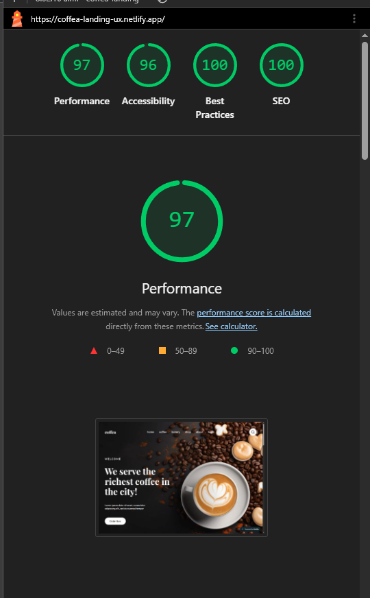

# TP4 | Landing Page Coffea

**Estudiante:** Cecilia Velzi  
**Materia:** Diseño UX-UI | Licenciatura en Sistemas, UADER

## Descripción

Landing page para Coffea, una cafetería ficticia. Presenta sus productos y la identidad visual de la marca mediante un diseño adaptable a distintos tamaños de pantalla.

### Link de deploy mediante Netlify: https://coffea-landing-ux.netlify.app/

## Secciones

- Presentación y categorías
- Carruseles de cafés y postres
- Promoción de granos, testimonios y newsletter
- Navegación y pie de página

## Tecnologías

HTML5 y CSS3. Las imágenes y los íconos del proyecto se encuentran en `assets/`.

## Estructura

```text
.
├── index.html
├── 404.html
├── netlify.toml
├── assets/
│   ├── icons/
│   └── img/
└── css/
	├── main.css
	├── base.css
	├── layout.css
	├── tokens.css
	├── utilities.css
	└── components/
```

`index.html` contiene las secciones de la landing. `css/main.css` importa los estilos base y los componentes; `assets/` reúne los recursos visuales. `netlify.toml` configura la publicación estática en Netlify.

## Convenciones

- Los estilos se organizan por capas CSS: `tokens`, `base`, `layout`, `components` y `utilities`.
- Las clases siguen una nomenclatura tipo BEM: bloque, elemento (`__`) y modificador (`--`), por ejemplo, `product-card__title`.
- Los valores compartidos de color, tipografía y espaciado se definen en `css/tokens.css`.
- Los estilos específicos de cada componente se mantienen en archivos separados dentro de `css/components/`.

## Ejecución local

Con Python 3 instalado, ejecutar desde la carpeta del proyecto:

```bash
py -m http.server 8000
```

Luego abrir [http://localhost:8000](http://localhost:8000) en el navegador. Para detener el servidor, presionar `Ctrl+C` en la terminal.

## Performance, Accessibility, Best Practices, SEO mediante Lighthouse
Como es requisito para termiado el sitio, se adjunta la demostración de las metricas con Lighthouse



